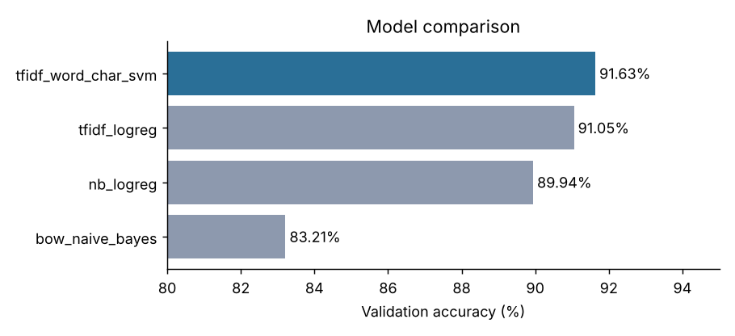
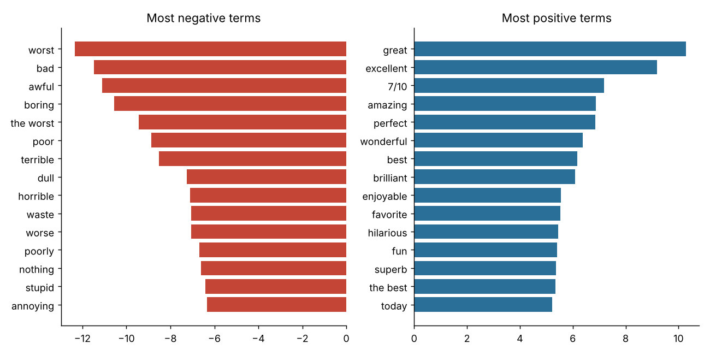

# Review Sentiment NLP

Sentiment classification of **50,000 IMDB movie reviews** with interpretable
TF-IDF models: preprocessing with negation handling, four models compared on a
validation set, one final test, explanation of what the model learned and an
error analysis.

## Results

| | |
|---|---|
| Test accuracy | **92.0%** (95% CI 91.5–92.6%) |
| ROC AUC | 0.975 |
| Best model | word + char TF-IDF + linear SVM |
| Simple baseline (Naive Bayes) | 83.2% |

Write-up: [`reports/findings.md`](reports/findings.md)

## Interesting findings
- **Negation marking flips meaning**: *boring* has weight -10.6, *not boring*
  has +0.7.
- **"7/10" is a top-3 positive feature.** Labels come from star ratings that
  reviewers often repeat in the text: a dataset shortcut worth knowing about.
- **Mixed reviews ("..., but ...") are the hard case**: 91.4% accuracy vs
  94.2% for one-sided reviews.
